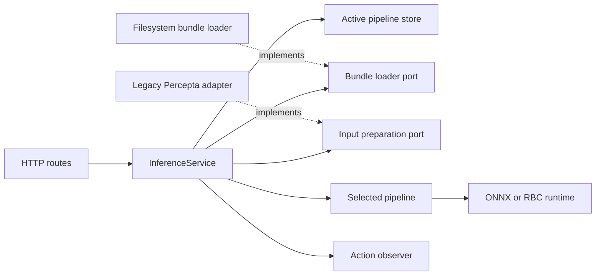

# Inference architecture — iteration 1

This document records the iteration 1 boundary and baseline. Subsequent work added
[configuration/candidate preparation](candidate-preparation.md) and
[bound Percepta execution](message-execution.md). The ONNX zero-on-failure and
rounding issues listed in the original audit below were corrected in iteration 4.

This iteration separates loading, active state, message preparation and execution.
It preserves the existing HTTP contract and algorithm calculations. It does not
introduce the future installation contract or safety layer.

## Boundaries and ownership

Previously, HTTP inference prepared Percepta data and calculated iCharging log
summaries; the global store both read bundle files and constructed engines; the
pipeline selected engines using global settings. These responsibilities now have
explicit boundaries:

| Area | Owns | Does not own |
| --- | --- | --- |
| `app/core` | Internal protocols, active record, in-memory state, unconfigured error | HTTP, settings, files, NumPy, ONNX, external backends |
| `app/application/service.py` | Load a candidate then publish it; select a pipeline, prepare input, execute and observe | Reading artifacts, concrete algorithms, transport responses |
| `app/adapters/bundles.py` | Read manifest and alias files; build every agent through an injected pipeline factory | Mutating active state |
| `app/adapters/runtime_factory.py` | Read runtime artifacts/configuration; construct ONNX/RBC and preprocessing with explicit providers | HTTP and activation |
| `app/adapters/legacy_input.py` | Existing envelope rules, flattening and community-field requirements | Installation discovery or a new message schema |
| `app/adapters/action_logging.py` | Existing iCharging action/phase diagnostics | Selecting or modifying decisions |
| `app/services/pipeline.py` | Delegate to the injected runtime and map actions to the agent identifier | HTTP, file reading when a factory is supplied |
| `app/services/runtimes` | ONNX execution/post-processing and rule/strategy dispatch | Deployment or installation composition |
| `app/services/rbc` | Existing strategy calculations, unchanged | Generic HTTP handling |
| `app/routers` and `app/dependencies.py` | HTTP validation, request IDs, status/error mapping and instance dependency lookup | Input transformations and runtime construction |
| `app/bootstrap.py`, `create_app()` | Select and connect production adapters, store, settings and hardware probe | Algorithm mathematics |

The version-1 manifest parser remains in `app/utils/manifest.py`, and HTTP DTOs
remain in `app/models`. They are external schemas, not the future installation
model. The application depends on protocols rather than importing those schemas.
Logging configuration remains process-wide infrastructure.

## Loading and execution

Both startup and `/admin/load` call the application service's `load()`. The
filesystem adapter resolves the current manifest/alias rules and constructs all
agent pipelines before returning a `PipelineRecord`. Only then does the service
publish that record. If any agent fails to load, the previous record remains
active. This preserves the earlier behavior; it is not yet persistent activation,
version coordination, rollback, or synchronization across worker processes.

An inference request selects one pipeline, passes its message through the input
adapter, executes that pipeline, and emits diagnostics. The selected pipeline
reference is retained for that call. Diagnostic failures are logged and do not
discard successful decisions. HTTP error mapping remains unchanged, including
the legacy 503 response for an unloaded agent.

`create_app()` creates independent application state by default. Its optional
`service`, `config` and `gpu_probe` arguments allow tests or other hosts to supply
their own dependencies. The default `app.main:app` uses the existing `app.state.store`
for compatibility with scripts and tests. The `PipelineStore.load()` facade also
remains available; new HTTP code uses the application service instead.

## Extension points

- Replace bundle acquisition by implementing `BundleLoader.load()` and injecting
  it into `InferenceService`. A loader returns a complete record or raises an
  error; it does not publish partial state.
- Replace runtime creation by supplying a `RuntimeFactory` to `InferencePipeline`
  or a different pipeline factory to `FilesystemBundleLoader`. A runtime exposes
  its agent index, providers and `infer()` operation. The HTTP route is unchanged.
- Replace message preparation by supplying `prepare_input(features, pipeline)`.
  The production adapter retains the current observations/forecasts/timestamp
  rules. Aliases and encoder order retain their existing runtime behavior.
- Replace storage through `ActivePipelines`. The current implementation is local
  memory; adding a shared store alone would not synchronize engine execution.
- Add diagnostics through `observe_actions`. This is a best-effort observer,
  **not a safety hook**: errors are swallowed and it must not change actions.

The future installation context, compatibility checks and safety correction need
explicit contracts and execution steps. They must not be hidden in diagnostics
or inferred from an unexpected key in a Percepta message. Deployment, training,
Mongo persistence and equipment actuation remain outside this component.

## Regression evidence

The baseline is commit `8b1b2ac` (`Support encoded entity manifest metadata`),
including the pre-existing local commit. Iteration 1 is isolated on
`codex/inference-iteration-1`; it does not publish or merge that earlier work.

- Baseline suite: **122 passed, 4 skipped** on Python 3.10.
- Final suite: **145 passed, 4 skipped** (23 new tests), including the existing
  dataset replays. Syntax compilation and whitespace checks also passed. The
  existing `python_multipart` deprecation warning is unchanged. These runs are
  regression checks, not a latency benchmark or deployment validation.
- `tests/fixtures/inference_reference.json` contains responses captured from the
  baseline implementation, before applying the refactor. It records 11 ordered
  sequences across eight real example bundles (33 requests): ordinary messages,
  missing community fields, and valid community messages with the explicit
  fixture patch. Numeric actions use absolute tolerance `1e-6`, with no relative
  tolerance. Agent/action keys, request IDs and error responses must match.
- Existing ONNX identity/alias and manifest tests remain in the suite. The four
  tests already marked as ONNX standby remain skipped; this is not evidence of
  full production ONNX/GPU validation.
- New core tests exercise injected execution, failed loads, agent selection,
  input/observer ordering and error propagation. A fresh interpreter verifies
  that the core and an injected pipeline do not import FastAPI, Pydantic, NumPy,
  ONNX, application settings or application logging.
- New integration tests verify independent API instances, their path settings,
  startup/shutdown, and preservation of the active record if a second agent fails.
- The generated OpenAPI document was compared with the baseline and is unchanged.

Run `python -m pytest -q` and `python -m compileall -q app tests` from the repository
root in an environment with `requirements.txt` installed. The full suite includes
longer dataset replays. No external backend or device access is needed.

## Known behavior deliberately deferred

Refactoring does not certify existing decisions as physically safe. These issues
remain separate follow-up changes with their own behavior tests:

1. ONNX execution exceptions currently return zero actions. Some input/shape
   incompatibilities can therefore appear as successful inference.
2. ONNX values are clamped and then rounded down. A non-decimal lower bound can
   be violated by that rounding order.
3. Unknown rule-policy types can fall through to default zero actions; manifest
   and runtime support need explicit validation before activation.
4. `/admin/load` checks the configured root for manifest/artifact-directory paths,
   but does not yet constrain every artifact, alias and configuration reference.
5. The Algorithms exporter and inference manifest contracts need reconciliation;
   this change does not add an exporter adapter.
6. Active selection is not persisted. Execution remains synchronous inside async
   routes, and state is not coordinated across workers.
7. There is no versioned installation context, composition-impact report, general
   safety correction or coordinated Percepta/algorithm activation yet.

The next iteration defines the bundle–installation–message contracts and their
compatibility rules on top of these boundaries.
