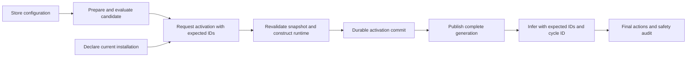

# Controlled activation and recovery — iteration 6

The service can now activate one prepared configuration/bundle/safety combination,
serve versioned decisions from its loaded runtime, and recover the last committed
activation after restart. Preparation still never activates a candidate implicitly.
Iteration 7 (the real Algorithms/Runtime/Percepta/Mongo integration and deployment)
is deliberately deferred.

## Three distinct references

| Reference | Meaning |
| --- | --- |
| Configuration revision | Immutable desired installation, algorithm interface, bindings, adapter and safety policy |
| Context ID | The installation snapshot explicitly declared current by the external coordinator |
| Activation ID | One committed local generation of the complete execution combination |

Uploading a configuration does not announce a physical change. `PUT
/admin/v1/installation` makes that announcement explicitly, with preconditions on
both current context and activation IDs. A changed snapshot gets a fresh context
ID, even if its human-readable revision was reused. An identical snapshot keeps
the ID. Changes currently compare the whole snapshot conservatively, including
metadata and provenance.

Once context changes, a previous activation no longer accepts new inference cycles.
Requests already admitted may finish, carrying the old IDs. The downstream consumer
must reject responses belonging to a previous context or activation. This is a
configuration transition, separate from the safety layer's correction of physical
limit violations within a supported configuration.

The coordinator must tell inference when installation composition changes. Inference
does not discover removed equipment or infer topology from arbitrary message keys.

## Local flow and external coordination



For an algorithm/configuration change against the same installation, the old runtime
continues serving while the new one is prepared. Publication exchanges the complete
local generation. A request captures that generation once and uses its bindings,
message adapter, runtime and safety policy throughout.

For a composition/message change requiring coordination:

1. Prepare matching revisions of the producer and inference candidate. Candidate
   preparation may happen before the physical/current-context change.
2. The external coordinator pauses cycle routing when overlapping versions cannot
   safely coexist, and drains or explicitly invalidates outstanding cycles.
3. Declare the current installation snapshot with the expected previous IDs.
4. Activate a ready candidate against that context and expected previous activation.
5. Observe successful operation **and** `/ready`, distribute the new IDs, then resume
   cycles in the matching producer format.
6. The consumer checks returned activation/context/cycle IDs before using actions.

These are coordinator obligations, not a distributed transaction implemented by
inference. This iteration implements the local side and the coordination contract.
It does not update another container or claim interruption-free arbitrary changes.
`cycle_id` is correlation, not an exactly-once actuator or a response cache.

## API and explicit migration

All managed mutations, lookups and `/inference/v2` require the existing bearer token.
`/health` and `/ready` expose status without administrative authentication.

| Route | Result |
| --- | --- |
| `PUT /admin/v1/installation` | Idempotent declaration of current installation; returns context ID and snapshot |
| `GET /admin/v1/installation` | Current context ID and snapshot |
| `POST /admin/v1/activations` | 202 operation receipt; revalidates and publishes asynchronously |
| `GET /admin/v1/operations/{id}` | Durable preparation or activation receipt |
| `GET /admin/v1/activations/{id}` | Generation identity, active/superseded state and current usability |
| `GET /admin/v1/status` | Storage counts and lifecycle state |
| `POST /inference/v2` | Loaded-generation decision, original proposal, final actions and safety audit |
| `GET /ready` | 200 for usable generation; 503 for unconfigured, context transition or recovery failure |
| `GET /health` | Process liveness, separately reporting configured/readiness state |

Installation declarations and activation requests require `Idempotency-Key`.
Identical retries return the original result; different content under the same key
returns 409. Replaying an old successful activation does **not** reactivate it.
`GET /ready` gives current state; historical receipts describe historical outcomes.

Activation supports `configuration.v2-draft` with `channels-1` and the explicit
physical safety profile, including off mode. V1 configurations remain available
for preparation/evaluation; migrate by submitting a new v2 configuration revision.
The previous draft `activation.v1-draft` is not silently accepted as executable.

Managed deployments use `/inference/v2`; `/inference` returns 409 so an unfenced
legacy call cannot bypass the managed lifecycle. Deployments without
`CONFIGURATION_STORE_DIR` retain their existing legacy inference behavior. Legacy
`/info` still describes the legacy service; managed metadata is in lifecycle status
and activation records.

Example installation declaration:

```json
{
  "schema_version": "installation-update.v1-draft",
  "expected_context_id": null,
  "expected_activation_id": null,
  "installation": { "...": "the complete InstallationContext document" }
}
```

Null is required explicitly for an initial empty state. Later calls must name the
current IDs, including the previous committed activation during a context transition.
A complete initial example is in `examples/safety_demo/installation-update.json`.

Activation request:

```json
{
  "schema_version": "activation.v2-draft",
  "candidate_id": "CANDIDATE_ID",
  "expected_activation_id": null,
  "expected_context_id": "CONTEXT_ID",
  "timeout_seconds": 120
}
```

The candidate's full installation must equal the declared context. Both expected
IDs are checked at admission and again transactionally at publication. A context
change during loading fails that operation rather than publishing stale bindings.
Interface semantics/order changes under the same manifest hash also require new
bundle evidence, even when no preparation baseline was supplied.

The optional activation deadline is 1–3600 seconds, default 120, measured from
admission. It is checked before native construction and before publication. It
prevents a late result from activating after its deadline. It does not forcibly
interrupt native code: a stuck engine retains its bounded worker slot and the
operation can remain running until it returns or the process restarts. A client
HTTP timeout is not proof of cancellation; inspect the durable receipt and current
state before retrying. Failed/uncertain operations need a new key after review.

Active cycle request (the inner Percepta message remains provisional and unchanged):

```json
{
  "expected_activation_id": "ACTIVATION_ID",
  "expected_context_id": "CONTEXT_ID",
  "cycle_id": "cycle-10",
  "features": { "observations": { "non_shiftable_load": 3 } }
}
```

The `decision.v2-draft` response contains activation/context/candidate IDs, prior
activation, activation time, cycle ID, execution revisions, proposed actions,
final actions, input evidence, providers and safety audit. Candidate evaluation
keeps its separate `evaluation.v2-draft` envelope. No response claims a device
acknowledgement or delivery to Mongo.

Typical failures: 409 stale precondition or unavailable candidate; 422 unsupported
configuration; 429 bounded admission exhausted; 503 no usable generation/recovery
failure; 507 configured snapshot/history budget exhausted. Invalid required inputs
remain 400 and native execution failures remain 500, with no fabricated actions.

## Commit, crash and recovery semantics

Native runtime construction runs outside the publication lock and outside the
ASGI event loop. Files are recopied from the private candidate snapshot, hashes,
manifest, provider, shapes, bindings and safety capabilities are revalidated, and
the execution context is compiled once.

A new generation owns a private `generations/{activation_id}/files` snapshot. Files
and directory entries are fsynced before SQLite may reference them. SQLite uses
`synchronous=FULL`; the new pointer, immutable activation record and successful
operation receipt commit in one transaction. Publication follows while holding the
same lock used by request admission and context declarations.

| Interruption | Restart behavior |
| --- | --- |
| Before activation transaction commits | Previous confirmed generation remains authoritative; unfinished operation becomes uncertain |
| After transaction commits, before in-memory publication/HTTP acknowledgement | New generation is authoritative; receipt is succeeded; restart reconstructs it |
| Current installation changed without a matching activation | Old activation remains historical/current pointer but unusable; readiness stays 503 |
| Committed files/provider/configuration cannot be revalidated | Explicit recovery failure; no silent fallback to an older generation |

If a commit acknowledgement becomes ambiguous in the live process, serving is
marked unavailable until restart reconciles the journal. A known transactional
precondition/deadline failure preserves the previous usable generation.

Recovery loads the exact committed generation snapshot rather than the mutable
bundle delivery directory. It validates into a separate runtime copy without
rewriting durable source bytes. Startup configuration/preparation files still do
not auto-activate a newly prepared candidate. Only an existing committed pointer
is recovered automatically.

These guarantees require a private persistent local filesystem honoring POSIX file
locking/fsync and SQLite durability. The tests kill real processes at commit
boundaries; they do not simulate hardware power loss or validate network filesystems.
One process owns the store; multiple Uvicorn workers cannot share it.

## Bounded work and retention

| Setting | Default | Scope |
| --- | --- | --- |
| `MAX_PENDING_PREPARATIONS` | 4 | Pending plus running preparations; duplicate keys do not add work |
| `MAX_STORED_CANDIDATES` | 64 | Persisted preparation-operation history, including failures |
| `MAX_CANDIDATE_BYTES` | 512 MiB | Maximum bytes per copied bundle |
| `MAX_SNAPSHOT_STORAGE_BYTES` | 4 GiB | Candidate/generation files, reserving one maximum-size copy per builder |
| `MAX_CONCURRENT_INFERENCES` | 4 | Executing and waiting managed cycles across generations |

There is one native construction/evaluation worker slot shared by preparation,
candidate evaluation and activation. One activation is admitted at a time. Active
inference uses the already loaded engine independently of that slot. Calls are
serialized per generation because runtimes have no universal concurrency guarantee.

At most one superseded generation may remain while its admitted cycles finish.
Further activation is refused while it is retained. At most two serving generations
plus one independent builder can coexist. Retired files are removed after their
last request, and orphan/superseded generation directories are cleaned on startup.
Candidate snapshots remain available for reviewed rollback; their history is not
silently deleted. When the history limit is reached, provision a reviewed larger
limit or migrate the store; do not remove live database rows manually.

The byte budget excludes SQLite metadata and HTTP payloads. Bounding bundle bytes
and native-instance counts is not a hard limit on the memory used by an arbitrary
ONNX graph. Hard process/container memory and request-size limits remain deployment
responsibilities; deployment itself is deferred with iteration 7.

## Rollback is another validated activation

Reactivating an older candidate requires a **new** activation request/key with the
current expected IDs. Its files and capabilities are rechecked. An old candidate
whose installation differs from the declared current house is rejected. If the
old algorithm can work with today's equipment, prepare a new configuration using
that bundle and the current installation/bindings/policy, then activate it.
Restoring an old configuration never makes a physically removed device available.

## Local example and verification

Start the synthetic two-charger example using [the safety guide](safety-correction.md).
Prepare a ready candidate as documented there, then:

1. PUT `examples/safety_demo/installation-update.json` to `/admin/v1/installation`
   with bearer token and a fresh idempotency key. Record the returned context ID.
2. Fill `activation.template.json` with that context ID and the candidate ID; POST
   it to `/admin/v1/activations` with another key. Poll the receipt until succeeded
   and require `/ready` to report that activation as usable.
3. Fill `inference-request.template.json` with the activation/context IDs; POST it
   to `/inference/v2`. The example proposes 6 + 6 kW and returns 6 + 2 kW with audit.
4. Restart using the **same state directory and settings**. Require `/ready` and
   repeat the cycle with the same IDs; the committed generation is recovered.

A real coordinator must distribute these values; editing templates manually is
only the local demonstration, not the deferred integration.

`tests/test_lifecycle.py` exercises loaded RBC and real ONNX, restart, immutable
snapshot integrity, configuration-only swaps, changed messages, the one-to-two
charger transition, safe/unsafe rollback, stale and repeated requests, concurrent
activation, bounded inference/preparation, storage limits, deadline expiry,
fsync/acknowledgement failures and real process exits on both sides of the commit.
An in-flight cycle is deliberately held across publication to verify that it
returns its original complete generation, and administrative requests remain
responsive during background loading. Draft 7 validation independently checks all four new schemas
and real decisions before and after recovery.

Verification on 2026-10-27: **385 tests passed, 4 skipped**, including **27 new
lifecycle tests**. The four skips and multipart deprecation warning predate this
iteration. All four new schemas also passed independent Draft 7 checks.

Export/check contracts and run the focused suite:

```sh
.venv/bin/python scripts/export_safety_schemas.py --check
.venv/bin/python scripts/export_contract_schemas.py --check
.venv/bin/python -m pytest tests/test_lifecycle.py -q
```

Iteration 7 remains deferred: real exporter capability adapters, Runtime context
compilation/coordinator, Percepta distribution and persistence, Mongo evidence,
container release and hardware deployment. No external component or equipment was
changed by this local iteration.
